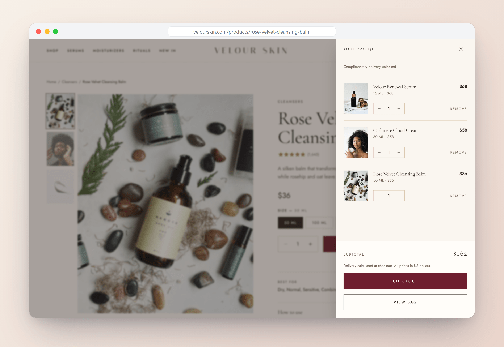
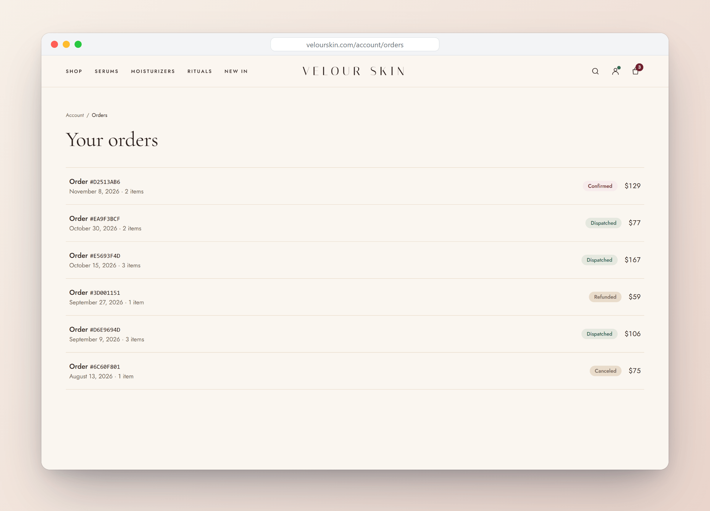
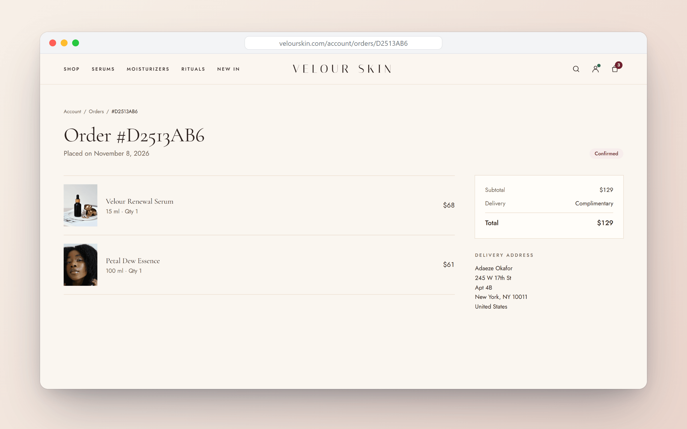
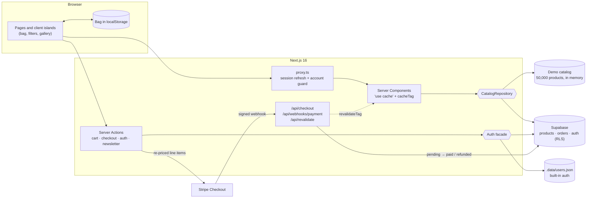

<div align="center">

# Velour Skin

**A luxury skincare storefront built for a 50,000-product catalog, with editorial design, cache-friendly server rendering, Supabase accounts and Stripe Checkout.**


[Features](#features) · [Design](#design) · [Screenshots](#screenshots) · [Tech stack](#tech-stack) · [Getting started](#getting-started)

</div>

<br>

<p align="center"></p>

## Overview

Velour Skin is a production-style e-commerce front end for a premium skincare brand selling in the US. It covers the whole path a shopper takes: browsing and filtering a large catalog, product pages with size variants, a slide-over bag, a validated checkout that hands off to Stripe, and an account area with order history.

It is built to stay fast at scale. Pages depend on a catalog repository interface that works against a deterministic in-memory catalog or against Postgres, data is cached with Next.js Cache Components and tag revalidation, and every integration is optional, so the store runs with zero configuration.

## Try the demo

With no environment variables at all, `npm run dev` gives you the full catalog, search, filters, product pages, the bag and working customer accounts (stored locally). Checkout shows a clear "payments are not enabled" notice instead of pretending to take money.

For the full demo with order history, run Supabase locally (see [Getting started](#getting-started)), set `DEMO_EMAIL` and `DEMO_PASSWORD` in `.env.local`, then:

```bash
npm run db:seed:demo
```

This creates that customer if needed and gives them six orders from the last three months (confirmed, dispatched, refunded and canceled). Sign in at `/account/login` and open **Orders**.


## Features

### An editorial home page

A full-bleed split hero, bestsellers, a category bento grid, a three-step "ritual" band and a newsletter sign-up, with masked headline reveals and scroll-triggered motion that respects reduced-motion settings.

<p align="center"></p>

### A catalog that browses well at 50,000 products

The full catalog and eight category pages have faceted filters (category, skin type, concern, price band, stock), five sort orders and link-based pagination. Search, filters, sort and pagination all work without JavaScript.

<p align="center"></p>

### Product pages and a slide-over bag

A photo gallery, size variants, quantity, skin-type and concern details, how-to-use and related products. Quick add opens the bag drawer, which shows a free-delivery progress bar ($5 flat, free over $100) and stays in sync across tabs.

| | |
| --- | --- |
|  |  |

### Accounts and order history

Customers sign in and see every order with its status, then open an order for items, totals and the delivery address.

| | |
| --- | --- |
|  |  |

<details>
<summary><b>Full feature list</b></summary>

**Shopping**
- Editorial home page: full-bleed split hero, bestsellers, category bento grid, a "ritual" band and newsletter sign-up, with masked headline reveals and scroll-triggered motion.
- Full catalog and 8 category pages with faceted filters (category, skin type, concern, price band, stock), 5 sort orders and link-based pagination.
- Product pages with a photo gallery, size variants, quantity, skin-type and concern details, how-to-use and related products.
- Search across the catalog.
- Bag as a slide-over drawer and a full page, with quick add from product cards, quantity limits, a free-delivery progress bar ($5 flat, free over $100) and persistence across tabs.

**Checkout and orders**
- Server-validated contact and delivery form with US states, ZIP codes and US phone numbers.
- Stripe-hosted payment, signature-verified webhook and an idempotent order state machine.
- Prices are always recalculated on the server; the browser only sends product IDs, variants and quantities.
- Customer accounts with order history and order detail (items, totals, delivery address, status).

**Platform**
- Two auth providers behind one facade: a built-in provider (scrypt, signed HttpOnly cookie, lockout after failed attempts) for zero setup, and Supabase Auth when configured.
- SEO: per-page metadata, canonical URLs, Open Graph images, JSON-LD (Organization, WebSite with SearchAction, Product, BreadcrumbList, ItemList), sitemap index in 10k-URL chunks, robots.txt and web manifest.
- Accessibility: landmarks and skip link, labelled filter groups, native `<dialog>` mobile menu, live regions, visible focus, reduced-motion support. Search, filters, sort and pagination work without JavaScript.
- Loading skeletons, error boundaries with retry and not-found pages for every route group.

</details>

## Design

- **A quiet luxury palette.** Warm ivory canvas, deep wine for primary actions and the ritual band, and soft sand and ochre for editorial panels. Colors are defined once as Tailwind 4 design tokens.
- **Editorial typography.** A high-contrast display face in wide-tracked capitals for headlines and the wordmark, a classic serif for product names and a clean geometric sans for interface text and small-caps labels.
- **Photography first.** Every product card and section is led by a fixed-aspect image, so the grid never shifts while images load.
- **Motion with restraint.** Masked headline reveals and scroll-in sections run through Motion's `LazyMotion` and switch off under `prefers-reduced-motion`.
- **Responsive.** On phones the header becomes a native `<dialog>` menu, filters move behind a **Filters** button and the product grid drops to two columns.
- **States.** Loading skeletons, error boundaries with retry and not-found pages for every route group.

<p align="center"></p>

<p align="center"></p>

## Screenshots

| | |
| --- | --- |
| <br>**Shop by category.** A bento grid of the eight categories. | <br>**Search.** Full-catalog search with the same filters and sorting. |

All screenshots come from the running app with the built-in demo catalog and the seeded demo customer: desktop at 1440×900 and mobile at 390×844, both at retina resolution. The store ships a light theme only.

## Tech stack

| Layer | Technology | Why |
| --- | --- | --- |
| Framework | Next.js 16.4 (App Router, Turbopack, Cache Components, Partial Prerendering), React 19.3 | A static shell from the CDN with request-specific parts streamed in |
| Language | TypeScript (strict), zod 4 | Every server boundary validates its input at runtime |
| Styling and motion | Tailwind CSS 4 with design tokens, Motion 14 (`LazyMotion`) | One palette for every component; only Motion's DOM features are loaded |
| Data and auth | Supabase (Postgres, Auth, Row Level Security) through `@supabase/supabase-js` 2 and `@supabase/ssr` | Customers can only read their own orders, enforced in the database |
| Payments | Stripe 23 (Checkout + webhooks) | Card data never touches the store |
| Tests | Vitest 4 and Testing Library, Playwright 1.64 | Unit, component and end-to-end coverage on desktop and mobile |
| Tooling | ESLint 9, tsx, Supabase CLI, GitHub Actions | `npm run verify` runs what CI runs |

## Architecture



**Key decisions**

- **A catalog that scales.** Pages only talk to a `CatalogRepository`. The demo implementation pre-computes one sorted index per sort order, so filtering a page is a single linear pass over 50,000 rows. The Supabase implementation uses composite indexes per sort order, GIN indexes for array facets and a generated `tsvector` column for search. Deep page offsets are capped to protect the database.
- **Caching with Cache Components.** Catalog queries run inside `"use cache"` with `cacheLife("hours")` and `products` / `product:<slug>` tags. Popular products and category shells are prerendered at build time; the rest render on first request and are then cached. `POST /api/revalidate` (bearer secret) refreshes one product or the whole catalog, for example from a database webhook. Request-specific UI streams behind `<Suspense>`, so the static shell comes from the CDN.
- **Payments the server controls.** The server validates the bag with zod, re-prices it from the catalog, stores a `pending` order and redirects to Stripe. An order becomes `paid` only when Stripe confirms it, through the signed webhook or a server-side session lookup on the success page. Both paths go through one state machine (`lib/order-status.ts`), so retries and reloads are safe. Full refunds move the order to `refunded`. Checkout refuses to start if orders cannot be stored, so a card is never charged without a record.
- **Auth that works with or without a backend.** One facade (`lib/auth.ts`) hides two providers. Supabase sessions are verified with `getClaims()` rather than trusted from the cookie. Row Level Security is the boundary: the catalog is read-only to the public and customers can only read their own orders. Server-only modules import `server-only`, so secret keys never reach a client bundle. Redirect targets are restricted to same-origin paths.
- **Core Web Vitals first.** LCP images are preloaded in the static shell, every image has a fixed aspect ratio, fonts are self-hosted, Motion loads only its DOM features, and the Supabase SDK is code-split until after hydration.


## Engineering highlights

- **One checkout pipeline.** The Server Action and the JSON API both call `beginCheckout`, which refuses to start without order storage, validates the bag and address with zod, re-prices every line from the catalog and only then creates the Stripe session.
- **An order state machine.** Allowed transitions live in one table, and every status update is conditional on the order's current state, so webhook retries and success-page reloads can't move an order backwards.
- **Scale built into the catalog.** The demo repository pre-computes one sorted index per sort order; the Supabase repository uses matching composite indexes, GIN indexes for facets and a generated `tsvector` column for search.
- **Server-only secrets.** Modules that hold keys import `server-only`, Supabase sessions are verified with `getClaims()`, and redirect targets are restricted to same-origin paths.

```ts
// src/app/lib/checkout.ts (trimmed)
export async function beginCheckout(input: { items: unknown; shipping: unknown }) {
  // Never take a payment we can't record.
  if (!isPaymentConfigured() || !isAdminConfigured()) {
    return { ok: false, status: 503, message: PAYMENTS_UNAVAILABLE_MESSAGE };
  }

  const items = cartLinesSchema.safeParse(input.items);
  if (!items.success) {
    return { ok: false, status: 400, message: items.error.issues[0]?.message ?? "Invalid bag" };
  }
  // ...validate the delivery address the same way...

  const priced = await repriceCart(items.data);
  if (priced.issues.length > 0 || priced.lines.length === 0) {
    return { ok: false, status: 409, message: "Some items in your bag are no longer available. ..." };
  }

  const orderId = await createPendingOrder({ /* ... */ lines: priced.lines, totals: priced.totals });
  const session = await createCheckoutSession({ orderId, /* ... */ lines: priced.lines, totals: priced.totals });
  await attachCheckoutSession(orderId, session.id);
  return { ok: true, url: session.url };
}
```

```ts
// src/app/lib/order-status.ts
export const ALLOWED_TRANSITIONS: Record<OrderStatus, readonly OrderStatus[]> = {
  pending: ["paid", "failed", "canceled"],
  paid: ["fulfilled", "refunded"],
  fulfilled: ["refunded"],
  failed: ["paid"],
  canceled: [],
  refunded: [],
};

// src/app/lib/orders.ts (inside updateOrderStatus)
const { data, error } = await admin
  .from("orders")
  .update({ ...changes, ...extra })
  .eq(column, value)
  .in("status", fromStates) // only from a legal previous state
  .select("id");
```

## Getting started

**Prerequisites**

- Node.js 22 (see `.nvmrc`; 20.9 or newer works) and npm 10+
- Optional: Docker and the Supabase CLI (`npx supabase`) for accounts with order history
- Optional: a Stripe test account and the Stripe CLI for real checkout

**Run with no services**

```bash
git clone <repository-url> velour-skin
cd velour-skin
npm install
cp .env.example .env.local
npm run dev
```

Open http://localhost:3000. Every value in `.env.local` can stay empty.

**Add Supabase (accounts and orders)**

```bash
npx supabase start
```

The repo includes `supabase/config.toml` (API on port 55321, Studio on 55323) and the schema migration, which is applied on start. Copy the printed API URL, publishable key and secret key into `.env.local`. For a hosted project, run the migration in `supabase/migrations/` and set the same three variables. In Supabase Auth, add `<site-url>/auth/confirm` as a redirect URL.

Optionally serve the catalog from Postgres instead of memory:

```bash
npm run db:seed
```

This upserts 8 categories and 50,000 products in batches. Then set `CATALOG_SOURCE=supabase`.

**Add Stripe (payments)**

```bash
stripe listen --forward-to localhost:3000/api/webhooks/payment
```

Set `STRIPE_SECRET_KEY` to a test key and `STRIPE_WEBHOOK_SECRET` to the printed `whsec_...` value, restart the dev server and pay with `4242 4242 4242 4242`.


<details>
<summary><b>Environment variables</b></summary>

| Name | Required | Description |
| --- | --- | --- |
| `NEXT_PUBLIC_SITE_URL` | For production | Public base URL for canonical links, sitemaps and Stripe redirects. Falls back to the Vercel URL. |
| `AUTH_SECRET` | For shared environments | Signs built-in auth session cookies. Generated automatically in `.data/` locally. |
| `NEXT_PUBLIC_SUPABASE_URL` | For accounts and orders | Supabase project URL. |
| `NEXT_PUBLIC_SUPABASE_PUBLISHABLE_KEY` | For accounts and orders | Publishable (anon) key. Safe in the browser; RLS protects every table. |
| `SUPABASE_SECRET_KEY` | For orders | Server-only key for order writes and webhooks. Never expose it. |
| `CATALOG_SOURCE` | No | `demo` (default) or `supabase`. |
| `STRIPE_SECRET_KEY` | For payments | Stripe secret key (`sk_test_...` in development). |
| `STRIPE_WEBHOOK_SECRET` | For payments | Signing secret for `/api/webhooks/payment`. |
| `REVALIDATE_SECRET` | For revalidation | Bearer token for `POST /api/revalidate`. |
| `DEMO_EMAIL`, `DEMO_PASSWORD` | For the demo seed | Customer that `npm run db:seed:demo` creates and fills with orders. Local Supabase only. |

</details>

<details>
<summary><b>Scripts</b></summary>

| Script | What it does |
| --- | --- |
| `npm run dev` | Development server. |
| `npm run build` / `npm start` | Production build and server. |
| `npm run lint` | ESLint. |
| `npm run typecheck` | Generate route types, then `tsc --noEmit`. |
| `npm test` | Unit and component tests. |
| `npm run test:coverage` | Unit tests with V8 coverage. |
| `npm run test:e2e` | Playwright tests (builds and starts the app). |
| `npm run db:seed` | Seed Supabase with the 50,000-product catalog. |
| `npm run db:seed:demo` | Create the demo customer and six sample orders (localhost only). |
| `npm run verify` | Lint, typecheck, test and build: what CI runs. |

</details>

<details>
<summary><b>Project structure</b></summary>

```
src/
  proxy.ts               session refresh and account route guard
  app/
    page.tsx             home page
    products/ categories/ search/   catalog, category pages, product detail, search
    cart/ checkout/      bag page, checkout and success pages
    account/             sign-in, register, overview, orders and order detail
    auth/confirm/        Supabase email confirmation
    policies/            returns, terms, privacy
    api/                 checkout, webhooks/payment, revalidate
    actions/             server actions: cart, checkout, auth, newsletter
    components/          layout, home, products, cart, checkout, account, motion, ui
    data/                categories, photography map, deterministic catalog generator
    lib/
      catalog/           CatalogRepository with demo and Supabase implementations
      supabase/          browser, server and admin clients
      auth.ts local-auth.ts        auth facade and built-in provider
      checkout.ts payment.ts orders.ts order-status.ts   checkout pipeline and order lifecycle
      pricing.ts shipping.ts currency.ts seo.ts validations.ts
    cart-store.ts        pure cart reducer and external store
    sitemap.ts robots.ts manifest.ts opengraph-image.tsx
supabase/                local config and SQL migration (schema, indexes, RLS)
scripts/                 catalog seeder and demo-order seeder
tests/unit/ tests/e2e/   Vitest and Playwright suites
```

</details>

## Testing & quality

```bash
npm test
npm run typecheck
npm run lint
npm run test:e2e
```

- **Unit and component (104 tests):** auth, cart reducer, catalog filtering and sorting at scale, currency formatting, orders, query parsing, SEO helpers, validation and key components.
- **End-to-end:** products, auth and checkout flows on desktop and mobile. Run against an existing server with `PLAYWRIGHT_BASE_URL=http://localhost:3000 npm run test:e2e`; set `E2E_STRIPE_ENABLED=1` against a server with Stripe test keys to include the redirect tests.
- **CI** (`.github/workflows/ci.yml`) runs lint, typecheck, unit tests with coverage and a build, then the Playwright suite in a second job.

## Deployment

The app targets Vercel; no `vercel.json` is needed.

- Configure Supabase in production. The built-in auth provider writes to disk, which serverless hosting does not keep.
- Add the variables from `.env.example`, marking `AUTH_SECRET`, `SUPABASE_SECRET_KEY`, `STRIPE_SECRET_KEY`, `STRIPE_WEBHOOK_SECRET` and `REVALIDATE_SECRET` as sensitive. Set `NEXT_PUBLIC_SITE_URL` to the production domain.
- In Stripe, add a webhook at `https://<domain>/api/webhooks/payment` for `checkout.session.completed`, `checkout.session.async_payment_succeeded`, `checkout.session.async_payment_failed`, `checkout.session.expired` and `charge.refunded`.
- In Supabase Auth, set the production Site URL and the `/auth/confirm` redirect.

## Roadmap

- Rate limiting on server actions and sign-up (at the edge or with a shared store).
- Guest order lookup by email and order number.
- Stripe Tax and inventory reservation during checkout.
- Transactional emails for shipping and refunds beyond Stripe receipts.
- Revalidate listing pages when a single product's price changes.
- Add a dark theme.